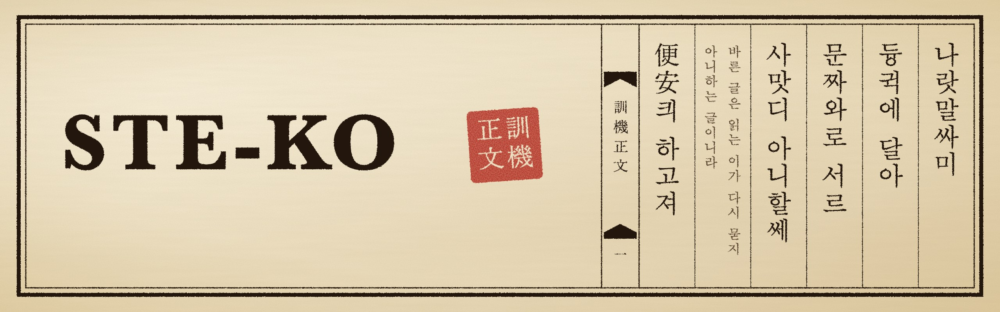

<p align="center">
  
</p>

<h3 align="center">읽는 사람이 한 번 읽고 행동할 수 있는 한국어 업무 글을 AI 에이전트가 쓰게 하는 스킬</h3>

<p align="center">
  <a href="https://github.com/junwonkim07/ste-ko-skill/actions/workflows/test.yml"></a>
  <a href="LICENSE"></a>
  
  
  
</p>

<p align="center">
  <a href="#빠른-시작">빠른 시작</a> ·
  <a href="#전후-비교">전후 비교</a> ·
  <a href="#규칙">규칙</a> ·
  <a href="#검사기">검사기</a> ·
  <a href="#원본과-다른-점">원본과 다른 점</a> ·
  <a href="#기여하기">기여하기</a> ·
  <a href="#english">English</a>
</p>

---

STE-KO 스킬은 Claude Code가 한국어 기술 문서, 커밋 메시지, PR 본문, 장애 보고, 업무 메시지를 읽기 쉽게 쓰도록 합니다.

규칙은 한국어 통제 언어 규격 [STE-KO](https://github.com/beamonic/ste-ko)를 따릅니다. STE-KO는 항공 정비 매뉴얼 규격 [ASD-STE100](https://www.asd-ste100.org/)의 방식을 한국어 문법에 맞게 새로 쓴 규격입니다. 이 스킬은 그 규칙을 그대로 강제하지 않고, 뜻을 바꾸지 않는 범위에서만 적용합니다.

## 특징

- 보고와 설명은 첫 두 문장 안에 결론과 현재 상태를 씁니다.
- `이를 통해` 같은 번역투, `보여집니다` 같은 이중피동, `검토를 진행했습니다` 같은 빈 동사를 고칩니다.
- 확인한 사실, 추론, 모르는 것을 나눕니다. 실행하지 않은 테스트를 통과했다고 쓰지 않습니다.
- `일 수 있다`, `약 30분` 같은 확신 수준과 조건, 부정, 수치는 바꾸지 않습니다. 없는 사실을 만들지 않습니다.
- 의존성 없는 파이썬 검사기가 기계로 셀 수 있는 규칙의 위반을 찾습니다. 검사기는 CI와 커밋 훅에서 돌릴 수 있습니다.
- 플러그인을 설치하면 출력 스타일이 함께 켜져서 모든 한국어 대화 답변에 같은 규칙을 씁니다.

## 빠른 시작

Claude Code에서 플러그인으로 설치합니다. 플러그인을 설치하면 스킬, 검사기, 출력 스타일이 함께 켜집니다.

```text
/plugin marketplace add junwonkim07/ste-ko-skill
/plugin install ste-ko@ste-ko-skill
```

터미널에서는 같은 일을 이 명령으로 합니다.

```bash
claude plugin marketplace add junwonkim07/ste-ko-skill
```

```bash
claude plugin install ste-ko@ste-ko-skill
```

새 세션을 엽니다. 그 뒤로 한국어 대화 답변은 모두 STE-KO `대화` 규칙으로 나옵니다. 문서, 커밋, PR을 쓰거나 고쳐 달라고 하면 스킬이 불립니다. 스킬 이름을 부르지 않아도 됩니다.

```text
이 장애 보고 읽기 쉽게 고쳐줘
README 번역투 빼줘
이 PR 본문 STE-KO로 다시 써줘. 무엇을 고쳤는지 표로도 보여줘
```

규칙을 끄려면 플러그인을 끕니다. 다시 켜면 출력 스타일도 다시 적용됩니다.

```bash
claude plugin disable ste-ko@ste-ko-skill
```

### 무엇이 켜지나

| 구성 요소 | 적용 범위 |
|---|---|
| 출력 스타일 [output-styles/ste-ko.md](output-styles/ste-ko.md) | 플러그인이 켜진 동안 모든 세션의 모든 답변. 다른 출력 스타일 설정보다 앞섭니다 (`force-for-plugin`) |
| 스킬 [SKILL.md](SKILL.md) | 문서, 커밋, PR, 업무 글을 쓰거나 고칠 때 |
| 검사기 [scripts/ste-ko-lint.py](scripts/ste-ko-lint.py) | 스킬이 10줄이 넘는 글을 검사할 때, 또는 직접 실행할 때 |

출력 스타일은 Claude Code의 코딩 지침을 지우지 않습니다 (`keep-coding-instructions: true`).

### 플러그인 없이 쓰기

스킬만 쓰려면 사용자 스킬 폴더에 받습니다. 이 방법으로는 출력 스타일이 켜지지 않습니다. 대화 답변에도 적용하려면 [references/chat-preferences.md](references/chat-preferences.md)의 블록을 `~/.claude/CLAUDE.md`에 넣습니다.

```bash
git clone https://github.com/junwonkim07/ste-ko-skill ~/.claude/skills/ste-ko
```

claude.ai와 데스크톱 앱 채팅은 플러그인 출력 스타일을 읽지 않습니다. 이 두 곳에서는 같은 파일의 블록을 설정 → 계정 → 프로필 → "Claude 지침"에 넣습니다.

## 전후 비교

<table>
  <tr>
    <th width="14%"></th>
    <th width="43%">고치기 전</th>
    <th width="43%">고친 후</th>
  </tr>
  <tr>
    <td>장애 보고</td>
    <td>금일 오후 배포 관련하여 이슈가 발생되어 확인해 본 결과, 결제 모듈 토큰 갱신 처리 로직 부분에서 문제가 있는 것으로 보여지며, 조만간 안정화 작업이 진행될 예정입니다.</td>
    <td>10월 12일 14시 배포 뒤 결제가 실패하고 있습니다. 결제 모듈이 만료된 토큰을 갱신하지 않는 것으로 보입니다(추론, 실패 로그 42건이 모두 <code>TokenExpired</code>). 수정 일정은 [담당자 확인 필요]입니다.</td>
  </tr>
  <tr>
    <td>커밋 메시지</td>
    <td>버그 수정 및 코드 개선, 테스트도 추가해서 전부 통과함</td>
    <td>토큰 만료 검사를 <code>&lt;</code>에서 <code>&lt;=</code>로 고침. 만료 시각과 같은 시각에 들어온 요청이 통과했음. <code>auth/token.py:88</code>. 테스트 2개 추가. 로컬에서 실행하지 않았음.</td>
  </tr>
  <tr>
    <td>작업 보고</td>
    <td>말씀하신 마이그레이션 작업 진행했습니다! 대부분 잘 된 것 같고 일부 테이블은 추후 확인이 필요할 것 같습니다.</td>
    <td>테이블 12개 중 10개를 옮겼습니다. <code>orders</code>, <code>refunds</code> 두 테이블은 외래 키 오류로 실패했습니다. 두 테이블은 내일 오전에 다시 옮기겠습니다.</td>
  </tr>
</table>

장애 보고에서는 입력에 없는 수정 일정을 만들지 않고 자리만 표시했습니다. 커밋 메시지는 쓴 사람의 말투(`~함`)를 그대로 뒀습니다. 작업 보고 예시는 사용자가 테이블 수와 실패 원인을 알려 준 경우입니다. 수치를 모르면 `대부분`과 `일부`를 그대로 둡니다. 예시를 더 보려면 [references/judgment.md](references/judgment.md)를 읽습니다.

## 규칙

스킬은 먼저 글이 놓일 자리(표면)를 정합니다. 문장 길이는 상한이 아니라 다시 읽어 볼 신호입니다.

| 표면 | 자리 | 문장 길이 신호 |
|---|---|---|
| `문서` | 기술 문서, 보고, 절차서 | 25어절 |
| `코딩` | 커밋, PR 본문, 코드 주석, 작업 보고 | 20어절 |
| `대화` | Slack, 이메일, 리뷰 코멘트, AI 답변 | 25어절 |
| `UI` | 버튼, 라벨, 안내, 오류 메시지 | 12어절 |

반드시 지키는 규칙은 7개입니다. 괄호 안 번호는 [STE-KO 규칙 본문](references/upstream/SPEC.md)의 번호입니다.

1. 결론과 현재 상태를 먼저 씁니다 (6.1).
2. 같은 대상은 같은 단어로 부릅니다 (1.2).
3. 사실, 추론, 미확인을 나눕니다 (6.2, 3.7).
4. 하지 않은 일을 했다고 쓰지 않습니다. 실패와 건너뛴 단계를 그대로 씁니다 (10.8, 6.4).
5. 이중피동을 쓰지 않습니다 (3.2).
6. 범위에 물결표를 쓰지 않습니다. `3~5개`는 마크다운에서 취소선이 됩니다 (8.1).
7. 되돌릴 수 없는 동작은 동작 앞에 알립니다 (7.1, 7.3).

행위자 밝히기, 동작은 동사로 쓰기, 명사를 4개 넘게 잇지 않기 같은 기본 규칙과 하지 않는 일은 [SKILL.md](SKILL.md)에 있습니다.

## 검사기

`scripts/ste-ko-lint.py`는 기계로 셀 수 있는 규칙만 봅니다. 파이썬 표준 라이브러리만 씁니다.

```bash
python3 ~/.claude/skills/ste-ko/scripts/ste-ko-lint.py docs/장애보고.md
python3 ~/.claude/skills/ste-ko/scripts/ste-ko-lint.py 'docs/**/*.md' --all
git log -1 --format=%B | python3 ~/.claude/skills/ste-ko/scripts/ste-ko-lint.py - --surface 코딩
```

```text
docs/장애보고.md:3	3.2	hard	이중피동 `보여지며`
docs/장애보고.md:3	1.3	warn	`를 통해` (A절 -을 통하-) → -으로 / -로
docs/장애보고.md:7	8.1	hard	범위에 물결표 `3~5` — 마크다운이 취소선으로 읽는다. `-` 를 쓴다
```

| 등급 | 무엇을 잡나 | 종료 코드 |
|---|---|---|
| `hard` | 이중피동, 범위에 쓴 물결표 | 1 |
| `warn` | 번역투, 공문투, 빈 동사, 명사화, 긴 문장 | 0 (`--strict`면 1) |
| `info` | 모호어, 완충어, 수치 표현 | 0, `--all`로 봅니다 |

결론 위치, 명사 나열, 사실과 추론 구분은 문맥이 필요해서 검사기가 보지 않습니다. 이 세 규칙은 스킬을 쓰는 에이전트가 판단합니다.

<details>
<summary>커밋 메시지 훅에 걸기</summary>

`hard` 위반이 있으면 커밋을 막습니다.

```sh
#!/bin/sh
# .git/hooks/commit-msg
python3 ~/.claude/skills/ste-ko/scripts/ste-ko-lint.py "$1" --surface 코딩
```

</details>

<details>
<summary>GitHub Actions에서 문서 검사하기</summary>

```yaml
- uses: actions/checkout@v4
- run: git clone --depth 1 https://github.com/junwonkim07/ste-ko-skill /tmp/ste-ko
- run: python3 /tmp/ste-ko/scripts/ste-ko-lint.py 'docs/**/*.md' --surface 문서
```

</details>

## 원본과 다른 점

원본 STE-KO를 그대로 강제하면 뜻이 바뀌거나 글이 딱딱해지는 곳이 있습니다. 판단 방향은 [Gudals0320/asd-ste100-kor](https://github.com/Gudals0320/asd-ste100-kor)를 참고했습니다.

| 원본 | 이 스킬 |
|---|---|
| 문장 25어절 상한 `필수` | 다시 읽어 볼 신호로만 씁니다 |
| `-일 수도 있습니다`, `약 30분` 금지 | 확신 수준과 추정치는 그대로 둡니다 |
| `일부`, `대부분` 금지 | 수치를 알 때만 수치로 바꿉니다 |
| 비유 금지 | 설명 글에서는 차이를 밝히고 씁니다 |
| `-하십시오`로 통일 | 사용자와 기존 글의 말투를 따릅니다 |
| 모든 답을 다음 행동으로 끝냄 | 실행이나 결정이 필요한 글에만 씁니다 |
| 출력 스타일에 원본 규칙을 그대로 넣음 | 출력 스타일에도 위 판단 기준을 넣습니다. 플러그인으로 켜는 방식은 같습니다 |

아래 표는 같은 문장 7개를 두 검사기로 돌린 결과입니다. 원본 검사기는 위반 5개를 잡지 못했고, 위반이 아닌 문장 1개를 위반으로 잡았습니다. 고친 내용은 원본에도 [beamonic/ste-ko#1](https://github.com/beamonic/ste-ko/pull/1)로 제안했습니다.

| 문장 | 원본 | 이 스킬 |
|---|---|---|
| 이 문제에 대해 설명한다. | 못 잡음 | `에 대해` (A절) |
| 이를 통해 해결했다. | 못 잡음 | `를 통해` (A절) |
| 장애로 인해 늦어졌다. | 못 잡음 | `로 인해` (A절) |
| 이슈가 있습니다. | 못 잡음 | `이슈가` (E절) |
| 설정이 변경되어졌다. | 못 잡음 | 이중피동 |
| 문제가 이번에 생겼다. | 오탐 (`문제가 있다`) | 잡지 않음 |
| 두 기능을 통합했다. | 잡지 않음 | 잡지 않음 (`-을 통하-`와 구별) |

## 구성

```text
.claude-plugin/plugin.json          플러그인 매니페스트
.claude-plugin/marketplace.json     마켓플레이스 목록
output-styles/ste-ko.md             모든 답변에 적용하는 출력 스타일
SKILL.md                            스킬 본문 (에이전트가 읽는 규칙)
references/judgment.md              느슨하게 적용하는 판단 기준과 전후 예시
references/chat-preferences.md      플러그인 없이 대화 답변에 적용하는 설정 블록
references/upstream/SPEC.md         STE-KO 규칙 본문 원문
references/upstream/dictionary.md   비승인 표현 대응표 원문
scripts/ste-ko-lint.py              검사기
tests/test_skill.py                 검사기와 스킬 파일 테스트
assets/banner.html                  배너 소스 (HTML)
```

## 기여하기

이슈와 PR을 환영합니다.

- 테스트는 `python3 -m unittest discover -s tests`로 돌립니다. PR을 열면 GitHub Actions가 Python 3.9와 3.12에서 같은 테스트를 돌립니다.
- 검사기를 고치면 `--self-test`에 잡아야 할 문장과 놓아줘야 할 문장을 함께 넣습니다.
- `references/upstream/`의 규칙 본문과 대응표는 원문 그대로 둡니다. 어휘 항목을 바꾸려면 원본 [beamonic/ste-ko](https://github.com/beamonic/ste-ko)에 제안합니다.
- 문서는 이 스킬 규칙으로 씁니다. PR을 열기 전에 검사기로 `hard` 위반이 없는지 확인합니다.

## 관련 프로젝트

- [beamonic/ste-ko](https://github.com/beamonic/ste-ko): 원본 STE-KO 규격, 대응표, 검사기
- [Gudals0320/asd-ste100-kor](https://github.com/Gudals0320/asd-ste100-kor): STE-KO를 느슨하게 고친 Codex용 작성 지침
- [danyuchn/asd-ste100-skill](https://github.com/danyuchn/asd-ste100-skill): 영어 글에 쓰는 ASD-STE100 스킬

## English

STE-KO skill is a Claude Code skill for Korean technical writing. It makes an AI agent write docs, commit messages, PR descriptions and work messages that a reader can act on after one read.

The rules come from [STE-KO](https://github.com/beamonic/ste-ko), a Korean controlled language based on the approach of ASD-STE100. This skill keeps the meaning of the source text. It does not remove hedges, estimates or the writer's register. It also includes a linter with no dependencies. The linter finds dictionary terms that the upstream linter does not find.

Install it as a Claude Code plugin with `/plugin marketplace add junwonkim07/ste-ko-skill` and `/plugin install ste-ko@ste-ko-skill`. The plugin also turns on an output style. The output style applies the rules to all chat replies while the plugin is on. For English text, use [danyuchn/asd-ste100-skill](https://github.com/danyuchn/asd-ste100-skill).

## 배너

배너는 옛 목판본의 판면을 본떴습니다. 굵은 바깥선과 가는 안선(광곽), 칸을 나누는 줄(계선), 가운데 접는 칸(판심)과 검은 어미가 있습니다. 오른쪽 큰 세로글은 훈민정음 언해 서문의 첫 구절과 `便安킈 하고져`를 현대 음절로 옮긴 것입니다. 가는 두 줄 주석 `바른 글은 읽는 이가 다시 묻지 아니하는 글이니라`는 이 저장소에서 새로 지었습니다. 낙관 `訓機正文`은 `訓民正音`(백성을 가르치는 바른 소리)을 바꿔 `기계를 가르치는 바른 글`이라는 뜻으로 지었습니다. 배너 소스는 [assets/banner.html](assets/banner.html)입니다.

## 출처와 라이선스

- [beamonic/ste-ko](https://github.com/beamonic/ste-ko) (MIT, Copyright (c) 2026 Beamonic): `references/upstream/`의 SPEC.md와 dictionary.md는 커밋 `fd351fe` 원문 그대로입니다. 검사기는 원본 `scripts/lint.py`를 고쳐 썼습니다.
- [Gudals0320/asd-ste100-kor](https://github.com/Gudals0320/asd-ste100-kor) (MIT): 판단 기준의 방향을 참고했습니다. 문장과 예시는 새로 썼습니다.
- ASD-STE100은 ASD(Aerospace, Security and Defence Industries Association of Europe)의 저작물입니다. 이 저장소에는 ASD-STE100 원문과 사전이 없습니다. 이 저장소는 ASD-STE100의 공식 번역이나 인증된 구현이 아닙니다.
- 배너의 언해 서문 구절은 15세기 문헌에서 왔습니다.

이 저장소는 [MIT 라이선스](LICENSE)를 따릅니다. 원본 고지는 [NOTICE.md](NOTICE.md)에 있습니다.
